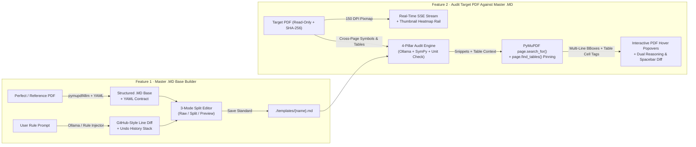

# TemplateAudit AI — Master `.MD` Standard Builder & Read-Only PDF Auditor

**TemplateAudit AI** is a modular, local-first engineering audit application built with **FastAPI**, **PyMuPDF (`fitz`) + `pymupdf4llm`**, **Python `sympy`**, **Local Ollama**, and a **Dark-Mode Split-Screen Frontend**.

It converts a reference PDF report into a human- and AI-editable **Master `.md` Standard** (complete with a **YAML Frontmatter Machine Contract**), and then audits target PDF reports against that standard **without ever modifying the original PDF on disk**—streaming real-time progress and drawing non-destructive, color-coded bounding boxes, table-cell tags, and interactive hover popovers directly over high-resolution page renders.

---

## System Architecture



---

## Project Directory Structure

```text
Report Checker/
├── main.py                              # FastAPI application factory & lifespan hooks
├── requirements.txt                     # Pinned Python dependencies
├── pyproject.toml                       # Modern Python packaging & linter config
├── .env.example                         # Environment variable reference
├── .gitignore                           # Git ignore rules
├── README.md                            # Comprehensive documentation
│
├── backend/                             # Modular Backend Package
│   ├── __init__.py
│   ├── config.py                        # Centralized constants, env vars & directory paths
│   ├── schemas.py                       # Pydantic v2 models (DiffLineItem, BoundingBoxPct, SymbolEntryOut)
│   ├── routers/                         # FastAPI APIRouter controllers
│   │   ├── __init__.py
│   │   ├── system.py                    # GET /api/health, GET /api/ollama/status
│   │   ├── templates.py                 # POST /api/templates/{extract-pdf,ai-assist,save}, GET /list
│   │   └── audit.py                     # POST /api/audit/{run,run-sample,stream,stream-sample,export-pdf}
│   ├── services/                        # Core domain & business logic services
│   │   ├── __init__.py
│   │   ├── pdf_service.py               # Read-only locking, SHA-256, pymupdf4llm + OCR fallback, 150 DPI rendering
│   │   ├── math_service.py              # SymPy evaluator, Cross-Page Symbol Registry & Dimensional Unit Analyzer
│   │   ├── ollama_service.py            # Local Ollama client, YAML Frontmatter sync & GitHub-style line diffing
│   │   ├── coordinate_service.py        # Multi-line bbox mapper & PyMuPDF page.find_tables() cell disambiguation
│   │   └── audit_service.py             # 4-pillar Master .MD comparator, Dual Reasoning & SSE event generator
│   └── utils/
│       ├── __init__.py
│       └── sample_factory.py            # Generates sample Perfect & Target PDFs + default .MD base
│
├── static/                              # Modular Dark-Mode Frontend
│   ├── index.html                       # Application shell (Feature 1 Split Builder + Feature 2 Streaming Auditor)
│   ├── css/
│   │   └── styles.css                   # Bounding-box overlays, glassmorphic hover popovers & GitHub diff styles
│   └── js/
│       ├── state.js                     # Centralized reactive state, undo history & visual category tokens
│       ├── api.js                       # REST + Server-Sent Events (SSE) streaming client
│       ├── markdown.js                  # Markdown table/heading + YAML Frontmatter Machine Contract renderer
│       ├── builder.js                   # Feature 1: 3-Mode Split Editor, AI Diff Drawer & Undo controller
│       ├── auditor.js                   # Feature 2: Thumbnail Heatmap Rail, Hover Popovers & Keyboard Triage
│       └── main.js                      # Application bootstrapper & mode navigation
│
├── templates/                           # Saved Master .MD Standards
│   └── Turbine_Thermal_Standard_v1.md   # Pre-seeded engineering standard template
│
├── samples/                             # Auto-generated Sample PDF Reports
│   ├── Perfect_Reference_Turbine_Report_2026.pdf
│   └── Target_Turbine_Report_With_Errors_2026.pdf
│
└── tests/                               # Automated Unit & Integration Test Suite
    ├── __init__.py
    └── test_pipeline.py                 # 6 unit & ASGI integration tests (SymPy, Symbols, Table Pinning, SSE)
```

---

## Core Capabilities

### Feature 1: Master `.MD` Base Builder
1. **Reference PDF-to-Markdown + YAML Machine Contract**: Uses `pymupdf4llm.to_markdown(pdf_path, page_chunks=True)` supplemented by PyMuPDF native table extraction and OCR fallback to convert a reference PDF into a structured `.md` standard with a YAML frontmatter schema.
2. **3-Mode Editor (`Raw .MD` | `Split View` | `Preview`)**: Edit raw Markdown and YAML frontmatter on the left while viewing the live rendered YAML Machine Contract card and formatted tables on the right simultaneously.
3. **AI-Assisted Rule Injection with GitHub-Style Inline Diff & Undo Stack**: Type natural-language instructions and apply them via local Ollama (`http://localhost:11434/api/chat`) or the deterministic rule injector. Review `+ Added` (green) and `- Removed` (red) lines in the **AI Diff Drawer** with one-click **Accept Diff** or **Revert / Undo**.
4. **Template Library (`./templates/`)**: Save any `.md` standard locally to `./templates/{name}.md`.

### Feature 2: Audit Target PDF Against Master `.MD` Base
1. **Strict Read-Only Guarantee & Real-Time SSE Streaming**: Uploaded Target PDFs are locked read-only (`os.chmod(path, stat.S_IREAD)`), verified via SHA-256 checksums, and streamed via Server-Sent Events (`/api/audit/stream`) so rendered 150 DPI pages appear immediately while the audit progresses.
2. **4-Pillar Master `.MD` Comparison + Cross-Page Symbol Registry**:
   - **Calculation & Math Verifier (`calculation`)**: Builds a **Cross-Page Symbol Registry** (`Dead Load = 18.40 MN`, `Loop A = 1250.0 kW`), substitutes cross-page variables, evaluates inline formulas and table sums deterministically with Python `sympy`, and checks dimensional unit consistency.
   - **Missing Reference Check (`missing_reference`)**: Flags citations, appendices, and external report codes required by the Master `.md` Base that are omitted from the Target PDF.
   - **Structure & Custom Rule Mismatch (`structure_mismatch`)**: Flags mandatory sections or YAML frontmatter rules missing from the Target PDF.
   - **Typo, Terminology & Dimensional Unit Check (`typo`)**: Detects spelling errors, non-SI unit notations (`kW/h`, `MW/h`, `degrees Kelvin`, `mps`), and incompatible unit additions (`kW + kWh`).
3. **Table-Cell Coordinate Disambiguation & Multi-Line Bounding Boxes**:
   - Intersects `page.search_for()` hits with PyMuPDF `page.find_tables()` cell coordinates (`Table 1 · Row 6, Col 4`) and returns multi-line bounding boxes (`bboxes`).
4. **Glassmorphic Hover Popovers, Thumbnail Heatmap Rail & Keyboard Triage**:
   - **Page Thumbnail & Issue Heatmap Rail**: Shows miniature page previews with color-coded issue dots (`Red`, `Amber`, `Cyan`) for instant navigation.
   - **Hover Popovers on PDF Bounding Boxes**: Hovering over any bounding box on the PDF displays Stated vs. SymPy math, `Suggestion to Fix`, and quick buttons for **Compare `.MD` (`Space`)** and **Ignore (`X`)**.
   - **Keyboard Shortcuts**:
     - `J` / `↓`: Next Issue
     - `K` / `↑`: Previous Issue
     - `X` / `I`: Ignore / Restore selected issue
     - `Space`: Toggle the **Master `.MD` Rule & Symbol Registry Comparison Drawer**

---

## REST & Streaming API Reference

| Method | Endpoint | Description |
| :--- | :--- | :--- |
| `GET` | `/api/health` | Service health check |
| `GET` | `/api/ollama/status` | Checks local Ollama connectivity and model availability |
| `POST` | `/api/templates/extract-pdf` | Extracts an uploaded Reference PDF into `.md` with YAML frontmatter |
| `POST` | `/api/templates/load-sample-perfect` | Extracts the built-in sample Reference PDF into `.md` |
| `POST` | `/api/templates/ai-assist` | Injects rules into `.md`, syncs YAML contract & returns `diff_lines` |
| `POST` | `/api/templates/save` | Saves a Master `.md` Standard to `./templates/{name}.md` |
| `GET` | `/api/templates/list` | Lists all saved Master `.md` files and their contents |
| `POST` | `/api/audit/run` | Audits an uploaded Target PDF against a selected Master `.md` Base |
| `POST` | `/api/audit/run-sample` | Audits the built-in sample error PDF against a Master `.md` Base |
| `POST` | `/api/audit/stream` | Streams real-time SSE audit progress and page renders for an uploaded PDF |
| `POST` | `/api/audit/stream-sample` | Streams real-time SSE audit progress for the built-in sample error PDF |
| `GET` | `/api/renders/{audit_id}/{image_name}` | Serves 150 DPI rendered page PNGs for the interactive viewer |
| `POST` | `/api/audit/{audit_id}/export-pdf` | Exports a separate `_review_copy.pdf` with native PDF annotations |

---

## Quick Start

### 1. Start the FastAPI Server

```powershell
$env:PYTHONUTF8 = "1"
$env:PYTHONPATH = "$PWD;$env:LOCALAPPDATA\LocalAuditAI-venv\Lib\site-packages"
& "$env:APPDATA\uv\python\cpython-3.11.17-windows-x86_64-none\python.exe" -m uvicorn main:app --host 127.0.0.1 --port 8000
```

Open **http://127.0.0.1:8000** in your browser.

### 2. Run the Automated Test Suite

```powershell
$env:PYTHONUTF8 = "1"
$env:PYTHONPATH = "$PWD;$env:LOCALAPPDATA\LocalAuditAI-venv\Lib\site-packages"
& "$env:APPDATA\uv\python\cpython-3.11.17-windows-x86_64-none\python.exe" -m unittest discover -s tests -v
```
